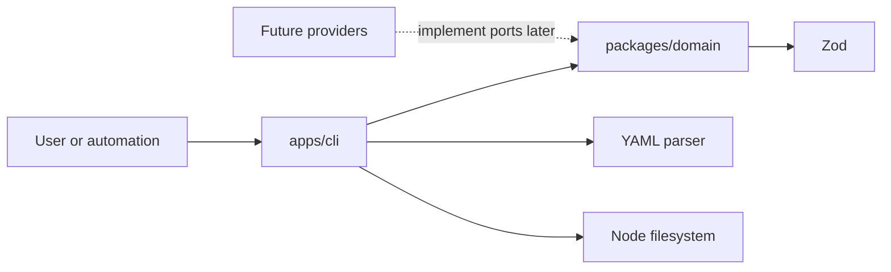

# CraftCompass architecture

## Current outcome

The foundation slice establishes a stable, explainable artifact boundary without
integrating any external engineering tool. It demonstrates that a human-editable
artifact can be decoded at the CLI edge, detected by explicit metadata,
validated by the domain, and summarized consistently.

The implementation contains only two workspaces:

- `packages/domain` owns domain concepts, Zod schemas, semantic invariants, and
  provider ports.
- `apps/cli` owns files, YAML, terminal output, and process exit codes.

Logical domain modules remain cohesive source files inside one package. They can
be extracted into packages only after independent behavior creates a meaningful
dependency boundary.

## Dependency direction



The domain must not import:

- filesystem or path APIs,
- YAML libraries,
- shell or process execution,
- GitNexus or MCP contracts,
- LLM SDKs,
- PIT, Stryker, or other mutation tools,
- HTTP or CI frameworks,
- GitHub or GitLab APIs.

`CodeGraphProvider` and `MutationTestingProvider` are explicit future
substitution boundaries required by the product brief. There are no provider
implementations or empty provider packages in this slice.

## Artifact flow

```text
read file
  -> parse YAML syntax
  -> inspect schema_version and kind
  -> select one strict domain schema
  -> validate structure and cross-field invariants
  -> evaluate time-sensitive exception validity with an injected clock
  -> return typed artifact or actionable issues
  -> render interface-specific output
```

Artifact type is never guessed from a filename and schemas are not tried in an
arbitrary order. Every supported document carries:

```yaml
schema_version: 1
kind: project_rule
id: RULE-DOMAIN-DEPENDENCY-001
```

Unknown fields are rejected so authoring mistakes do not silently disappear.
Unknown versions and kinds fail before detailed validation with one direct
compatibility error.

## Stable and deterministic behavior

- Serialized enum values and YAML fields use lower snake case.
- Confidence is a finite inclusive value from `0` through `1`.
- YAML serialization sorts mapping keys.
- Inspection lists derived categories in lexical order.
- Tests inject the UTC reference date used for exception expiration.
- Important behavior uses explicit assertions, not snapshots.
- Source and evidence references are preserved on semantic round trips.

The CLI's default clock makes expiration meaningful in real use. The domain
accepts an explicit clock value so tests and callers can reproduce a decision.

## Evidence before judgment

Three separate evidence concepts prevent provenance from being collapsed:

1. `SourceReference` attributes knowledge.
2. `EvidenceReference` points to project facts, decisions, or tool artifacts.
3. `AssuranceEvidence` records normalized verification evidence and optional
   execution metadata.

`ProjectObservation.type` explicitly distinguishes fact, interpretation,
assumption, uncertainty, decision, and known debt. An inferred architecture is
therefore never serialized as an observed fact merely because its confidence is
high.

## Requirement precedence and reconciliation

The attached implementation request is the controlling refinement for this
milestone. It resolves several differences in the product documents:

- The original brief's GitNexus/rule-generation/diff-review slice and the
  assurance brief's GitNexus/PIT slice are later milestones. This slice is
  domain-only.
- `craft validate` and `craft inspect` replace the earlier proposed
  `craft assurance validate` surface for this milestone.
- The four-type observation sketch is expanded to the six types required
  elsewhere in the brief.
- Review Level 3 is documented as a future model but cannot appear in schema
  version 1.
- Uppercase enum examples are normalized to lower snake case in artifacts.
- The target knowledge catalog sizes of 30–50, ten, and five refer to later
  stages; this foundation has the two requested principles and one current
  position.
- `product_decision`, omitted from the proposed `KnowledgeMaturity` type, is
  included. `contested` and `superseded` are modeled as lifecycle states rather
  than source/maturity categories.
- A mutation score may be reported as context, but cannot be the decision
  strategy.

The assurance document also contains an empty inline path in its relationship
note. `docs/product/` is treated as canonical because both source documents
already reside there and the implementation request names that path.

## Deferred boundaries

No generic repositories, service locators, dependency-injection container,
event bus, plugin framework, database, ORM, broker, web framework, or deployment
platform is present.

Future package candidates become justified when their behavior exists:

- filesystem-based repository observation,
- artifact registry and cross-file reference validation,
- project-rule adaptation,
- rule and instruction compilation,
- fake and real code-graph adapters,
- mutation-provider adapters and baselines,
- quality-gate orchestration,
- review policy derivation,
- evidence-ledger persistence,
- MCP and CI adapters.

The next recommended boundary is a filesystem repository-observation adapter.
It can produce real technology facts while keeping all interpretation and
provider contracts stable.
