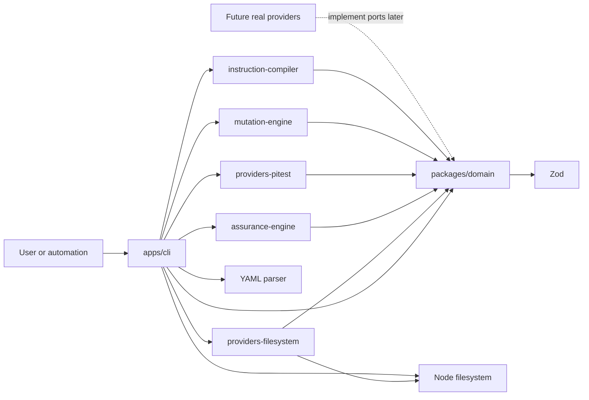

# CraftCompass architecture

## Current outcome

The completed foundation, repository-observation, deterministic-adaptation,
graph-assurance, mutation-ingestion, and instruction-compilation slices provide
an end-to-end local workflow without claiming unavailable integrations. A
repository can be observed without inventing facts; connected artifacts can
produce candidate rules and a change-specific assurance plan; attested PIT
output can be evaluated against human-governed debt; active guidance can become
bounded agent instructions.

The implementation contains seven workspaces:

- `packages/domain` owns domain concepts, Zod schemas, semantic invariants,
  provider ports, reference resolution, and pure rule derivation.
- `packages/providers-filesystem` owns safe repository traversal and structural
  package.json/Maven parsing.
- `packages/assurance-engine` owns change-impact normalization, a synthetic
  graph provider, mutation-scope derivation, and assurance planning.
- `packages/providers-pitest` owns bounded PIT XML parsing and attested
  provider-neutral normalization.
- `packages/mutation-engine` owns baseline creation, comparability, debt deltas,
  and policy evaluation.
- `packages/instruction-compiler` owns bounded, deterministic agent guidance.
- `apps/cli` owns files, YAML, terminal output, atomic instruction installation,
  and process exit codes.

## Dependency direction



The domain must not import filesystem or path APIs, YAML libraries, process
execution, GitNexus or MCP contracts, LLM SDKs, mutation tools, HTTP or CI
frameworks, or source-forge APIs.

`CodeGraphProvider` and `MutationTestingProvider` remain explicit substitution
boundaries. The filesystem package implements repository observation rather
than either port. The code-graph implementation is permanently synthetic and
fixture-backed. The PIT adapter ingests reports but never executes PIT.

## Artifact flow

```text
read file
  -> parse exactly one YAML document
  -> inspect schema_version and kind
  -> select one strict domain schema
  -> validate structure, cross-field invariants, and time-sensitive state
  -> return a typed artifact or actionable issues
  -> render interface-specific output
```

Multi-artifact commands add:

```text
input files/directories
  -> canonicalize explicit roots; reject artifact/descendant symlinks
  -> enforce per-file, artifact-count, traversal-entry, aggregate-size, and depth budgets
  -> recursively sort and deduplicate YAML paths
  -> parse and validate every artifact in lexical order
  -> enforce global IDs and typed references
  -> derive from typed project/change context
  -> validate and serialize a candidate rule or assurance plan
```

Mutation import adds a second trust boundary:

```text
bounded no-follow XML read
  -> strict structural and semantic PIT parsing
  -> exact outcome partition and stable semantic IDs
  -> plan/scope/configuration/version attestation
  -> provider-neutral mutation report
  -> active-baseline comparability and exact debt delta
  -> pass, fail, or inconclusive policy result
```

Artifact type is never guessed from a filename and schemas are not tried in an
arbitrary order. Unknown fields are rejected. Unknown versions and kinds fail
before detailed validation with one direct compatibility error.

## Stable and deterministic behavior

- Serialized enum values and YAML fields use lower snake case.
- Confidence is finite and inclusive from `0` through `1`.
- YAML serialization sorts mapping keys.
- Tests inject the UTC reference date used for expiration.
- Important behavior uses explicit assertions, not snapshots.
- Source and evidence references survive semantic round trips.
- Registry results and issues are independent of input order.
- Repository profiles contain only repository-relative POSIX evidence paths.
- Candidate rules remain non-blocking until a human activates them.
- Missing or degraded graph evidence lowers confidence and keeps limitations.
- Mutation comparisons use exact IDs and canonical scope, never a score.
- Generated instructions use a caller-supplied effective date and stable order.

The CLI's default clock makes expiration meaningful in real use. Pure domain
and compiler boundaries accept explicit clock values so tests and callers can
reproduce a decision.

## Evidence before judgment

Three separate evidence concepts prevent provenance from being collapsed:

1. `SourceReference` attributes knowledge.
2. `EvidenceReference` points to project facts, decisions, or tool artifacts.
3. `AssuranceEvidence` records normalized verification evidence and optional
   execution metadata.

`ProjectObservation.type` distinguishes fact, interpretation, assumption,
uncertainty, decision, and known debt. An inferred architecture is never
serialized as an observed fact merely because its confidence is high.

Detected technologies and modules carry their own evidence. Unsupported and
malformed repositories may legitimately have empty technology/module lists
when their uncertainty is explicit. `adaptation_context` is typed and
evidence-linked; derivation never mines free-form observation prose. Confirmed
module roles require a human-backed project decision.

## Repository observation trust boundary

The filesystem provider recognizes only behavior backed by fixtures and real
parsers:

- package.json, package-manager declarations/lockfiles, and tsconfig,
- Maven project models, trusted group/artifact coordinates, Java source roots,
  and declared modules.

It rejects manifest symlinks, oversized manifests, XML DOCTYPE declarations,
repository escapes, root-resolving modules, and filesystem access errors.
Malformed input becomes visible uncertainty when partial observation is safe.
Package-manager conflicts do not become a guessed tool.

## Artifact registry and derivation

The registry proves globally unique artifact IDs and resolves:

- rules to projects, principles, observations, modules, and exact evidence,
- assurance profiles and plans to their projects and change inputs,
- mutation reports and baselines to exact provider, scope, totals, debt, and
  exception records,
- evidence `source_ref` values to unique knowledge sources.

Artifact and source IDs are registry-global. Evidence IDs are project-scoped
for project-connected artifacts and artifact-scoped for standalone reports;
conflicting definitions within a scope remain errors even when IDs match.

The first rule recipe supports only `ARCH-DEPENDENCY-DIRECTION-001`.
Greenfield business systems, legacy systems, and intentionally simple tools
receive materially different candidate rules. Missing or ambiguous context
produces `requires_decision`; superseded knowledge is not derived.

## Change assurance and mutation trust boundaries

Graph topology is evidence, not a design verdict. Available, degraded,
unavailable, and provider-error states remain distinct. Diff-only fallback is
explicitly limited and confidence-capped. The assurance engine derives only
Review Levels 0–2 and makes higher risk or weaker evidence require more human
review.

The PIT parser bounds bytes, nodes, strings, mutations, actions, tests, and
entity decoding. Provider source names are not promoted to repository paths. A
report is complete only when an execution attestation exactly matches the
selected assurance plan and scope. Empty, partial, timed-out, error-bearing, or
incomparable evidence is inconclusive.

Baselines are candidates until a human activates them. Accepted-risk mutation
debt must resolve to an active, unexpired exception with human evidence.
Equivalent mutations remain candidates until confirmed.

## Generated agent guidance

Instruction compilation consumes a fully validated registry at an injected
effective date. It includes active rules and assurance policy, but deliberately
omits evidence text, rationale, provider configuration, and other untrusted
operational detail. All displayed identifiers, statements, and scopes are
escaped and bounded.

The assurance profile defines only a maximum human-review level. A
change-specific assurance plan is authoritative; without one, agents must use
conservative Level 0 review. Decisions that can affect the task are explicit
stop points. Installation creates a missing root `AGENTS.md` atomically but
never overwrites any existing file, including drifted generated content.

## Requirement precedence and reconciliation

The attached implementation request controls this milestone where it refines
the product documents:

- Real GitNexus, live diff discovery, and mutation execution remain later
  milestones.
- The observation sketch expands to fact, interpretation, assumption,
  uncertainty, decision, and known debt.
- Review Level 3 is documented only as a future model and cannot appear in
  schema version 1.
- Serialized enum values use lower snake case.
- Knowledge-catalog size targets refer to later stages.
- `product_decision` is a maturity while `contested` and `superseded` are
  lifecycle states.
- Mutation score is contextual only and never a decision strategy.

## Deferred boundaries

No generic repositories, service locators, dependency-injection container,
event bus, plugin framework, database, ORM, broker, web framework, or deployment
platform is present.

Future boundaries become justified when their behavior exists:

- a real code-graph adapter with explicit index identity and freshness evidence,
- mutation execution behind an injectable process boundary,
- quality-gate orchestration,
- evidence-ledger persistence,
- MCP and source-forge adapters,
- a separately versioned Review Level 3.

The next recommended vertical slice is a real but read-only code-graph adapter
with explicit index identity and freshness evidence. It must preserve
unavailable/degraded states and must not turn graph topology into a
craftsmanship verdict.
