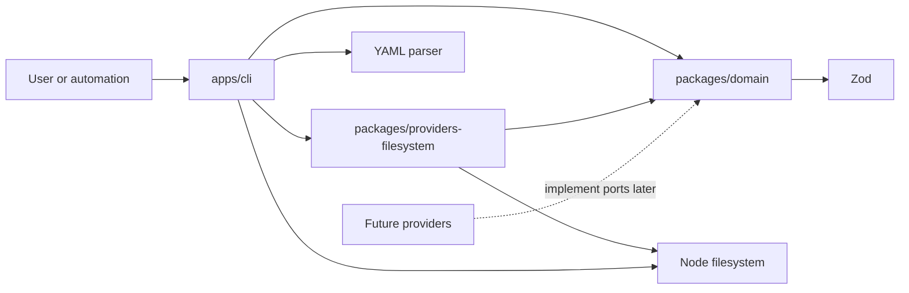

# CraftCompass architecture

## Current outcome

The completed foundation, repository-observation, and deterministic-adaptation
slices establish a stable artifact boundary and a first useful project workflow.
A repository can be observed without inventing facts, its resulting profile can
join a validated artifact registry, and typed context can produce an
explainable non-blocking project-rule candidate.

The implementation contains three workspaces:

- `packages/domain` owns domain concepts, Zod schemas, semantic invariants, and
  provider ports, reference resolution, and pure rule derivation.
- `packages/providers-filesystem` owns safe repository traversal and structural
  package.json/Maven parsing.
- `apps/cli` owns files, YAML, terminal output, and process exit codes.

Logical domain modules remain cohesive source files inside one package. They can
be extracted into packages only after independent behavior creates a meaningful
dependency boundary.

## Dependency direction



The domain must not import:

- filesystem or path APIs,
- YAML libraries,
- shell or process execution,
- GitNexus or MCP contracts,
- LLM SDKs,
- PIT, Stryker, or other mutation tools,
- HTTP or CI frameworks,
- GitHub or GitLab APIs.

`CodeGraphProvider` and `MutationTestingProvider` remain explicit future
substitution boundaries. The filesystem package implements a concrete
repository-observation boundary rather than either of those ports.

## Artifact flow

```text
read file
  -> parse YAML syntax
  -> require exactly one YAML document
  -> inspect schema_version and kind
  -> select one strict domain schema
  -> validate structure and cross-field invariants
  -> evaluate time-sensitive exception validity with an injected clock
  -> return typed artifact or actionable issues
  -> render interface-specific output
```

Multi-artifact commands add:

```text
input files/directories
  -> canonicalize explicit roots; reject artifact/descendant symlinks
  -> enforce per-file, artifact-count, traversal-entry, aggregate-size, and depth budgets
  -> recursively sort and deduplicate YAML paths
  -> parse and validate every artifact in lexical order
  -> enforce global IDs and typed references
  -> derive from typed project context
  -> validate and serialize a candidate rule
```

Artifact type is never guessed from a filename and schemas are not tried in an
arbitrary order. Every supported document carries:

```yaml
schema_version: 1
kind: project_rule
id: RULE-DOMAIN-DEPENDENCY-001
```

Unknown fields are rejected so authoring mistakes do not silently disappear.
Unknown versions and kinds fail before detailed validation with one direct
compatibility error.

## Stable and deterministic behavior

- Serialized enum values and YAML fields use lower snake case.
- Confidence is a finite inclusive value from `0` through `1`.
- YAML serialization sorts mapping keys.
- Inspection lists derived categories in lexical order.
- Tests inject the UTC reference date used for exception expiration.
- Important behavior uses explicit assertions, not snapshots.
- Source and evidence references are preserved on semantic round trips.
- Registry results and issues are independent of input order.
- Repository profiles contain only repository-relative POSIX evidence paths.
- Candidate rules use stable recipe IDs and remain non-blocking until accepted.

The CLI's default clock makes expiration meaningful in real use. The domain
accepts an explicit clock value so tests and callers can reproduce a decision.

## Evidence before judgment

Three separate evidence concepts prevent provenance from being collapsed:

1. `SourceReference` attributes knowledge.
2. `EvidenceReference` points to project facts, decisions, or tool artifacts.
3. `AssuranceEvidence` records normalized verification evidence and optional
   execution metadata.

`ProjectObservation.type` explicitly distinguishes fact, interpretation,
assumption, uncertainty, decision, and known debt. An inferred architecture is
therefore never serialized as an observed fact merely because its confidence is
high.

Detected technologies and modules also carry their own evidence. Unsupported
and malformed repositories may legitimately have empty technology/module lists
as long as their uncertainty is explicit. `adaptation_context` is typed and
evidence-linked; derivation never mines free-form observation prose. A module's
boundary status is separate from its optional `architecture_role`. Semantic
roles carry their own candidate/confirmed status, confidence, observation
references, and exact evidence closure. A confirmed role requires a
human-backed project decision.

## Repository observation trust boundary

The filesystem provider recognizes only behavior backed by fixtures and a real
parser:

- package.json, package-manager declarations/lockfiles, and tsconfig,
- Maven project models, trusted group/artifact coordinates, Java source roots,
  and declared modules.

It rejects manifest symlinks, oversized manifests, XML DOCTYPE declarations,
repository escapes, root-resolving modules, and filesystem access errors.
Malformed input becomes visible uncertainty when partial observation is safe.
Package-manager conflicts do not become a guessed tool.

## Artifact registry and derivation

The registry proves globally unique artifact IDs and resolves:

- rule to project and principles,
- rule observation references inside that project,
- rule module references inside that project,
- exact rule evidence back to those observations and modules,
- assurance profile/plan project references,
- evidence `source_ref` values to unique knowledge sources.

Artifact and source IDs are registry-global. Evidence IDs are project-scoped
for project, rule, and assurance artifacts, and artifact-scoped for standalone
reports; conflicting definitions within a scope remain errors even when their
IDs match. Mutation-baseline references remain intentionally unresolved until a
baseline artifact exists.

The first derivation recipe supports only
`ARCH-DEPENDENCY-DIRECTION-001`. Greenfield business systems, legacy systems,
and intentionally simple tools receive materially different candidate rules.
Missing/ambiguous context produces `requires_decision`; superseded knowledge is
not derived.

## Requirement precedence and reconciliation

The attached implementation request is the controlling refinement for this
milestone. It resolves several differences in the product documents:

- Real GitNexus, diff review, and mutation execution remain later milestones.
- `craft validate` and `craft inspect` replace the earlier proposed
  `craft assurance validate` surface for this milestone.
- The four-type observation sketch is expanded to the six types required
  elsewhere in the brief.
- Review Level 3 is documented as a future model but cannot appear in schema
  version 1.
- Uppercase enum examples are normalized to lower snake case in artifacts.
- The target knowledge catalog sizes of 30–50, ten, and five refer to later
  stages; the current repository has the two requested principles and one
  current position.
- `product_decision`, omitted from the proposed `KnowledgeMaturity` type, is
  included. `contested` and `superseded` are modeled as lifecycle states rather
  than source/maturity categories.
- A mutation score may be reported as context, but cannot be the decision
  strategy.

The assurance document also contains an empty inline path in its relationship
note. `docs/product/` is treated as canonical because both source documents
already reside there and the implementation request names that path.

## Deferred boundaries

No generic repositories, service locators, dependency-injection container,
event bus, plugin framework, database, ORM, broker, web framework, or deployment
platform is present.

Future package candidates become justified when their behavior exists:

- rule and instruction compilation,
- fake and real code-graph adapters,
- mutation-provider adapters and baselines,
- quality-gate orchestration,
- review policy derivation,
- evidence-ledger persistence,
- MCP and CI adapters.

The next recommended boundary is a fixture-backed code-graph provider and pure
assurance-planning behavior. It must preserve unavailable/degraded evidence and
must not turn graph topology into a craftsmanship verdict.
