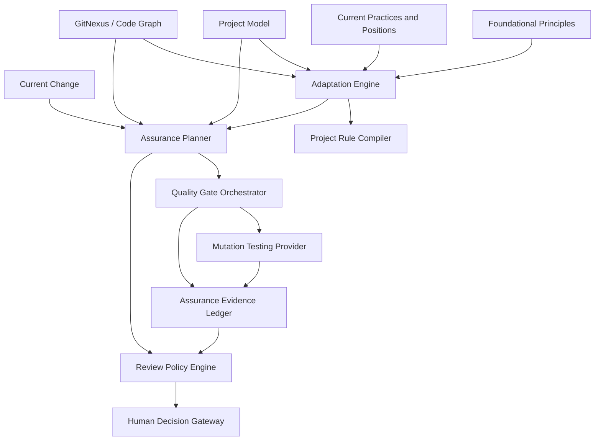

# CraftCompass: Assurance Strategy and Current-Practice Integration

> **Companion project brief for building CraftCompass in Codex**
>
> This document extends the original CraftCompass project brief with:
>
> - current statements and practices from Robert C. Martin,
> - AI-agent development workflows,
> - mutation testing,
> - risk-based human review,
> - assurance planning,
> - quality-gate orchestration,
> - GitNexus-assisted test scoping,
> - and a concrete implementation backlog.

**Working title:** CraftCompass  
**Document status:** Architecture and MVP proposal  
**Last reviewed:** 2026-07-26  
**Relationship to the original brief:** Companion document; both files should be placed in the repository under ``.

---

## 1. Why this extension exists

The original CraftCompass concept focuses on translating general software-craftsmanship principles into project-specific rules.

That remains necessary, but it is no longer sufficient for AI-agent development.

When agents can generate code much faster than humans can inspect it, the quality system cannot depend entirely on a person reading every changed line. The development process needs executable constraints and independent evidence that the generated result:

- implements the intended behavior,
- has meaningful tests,
- respects architectural boundaries,
- remains maintainable,
- does not introduce unacceptable risk,
- and can be changed safely later.

Robert C. Martin has recently described a workflow in which he does not personally review all agent-written implementation code. Instead, he evaluates measurable properties such as test coverage, dependency structure, complexity, module sizes, and mutation-testing results. His current training material on AI agents explicitly combines acceptance testing, unit testing, mutation testing, code-quality analysis, dependency checking, and disciplined specification.

CraftCompass should treat this as an important modern extension of classical software craftsmanship.

However, CraftCompass must not turn one current statement into a universal command such as:

```text
Never perform human code reviews.
```

The correct product interpretation is:

> As code-generation throughput increases, assurance must increasingly come from executable specifications, independent verification, mutation testing, architectural constraints, and risk-based review. Human attention moves toward intent, architecture, security, exceptions, and high-risk behavior.

---

## 2. Source interpretation policy

CraftCompass must distinguish between several kinds of knowledge.

### 2.1 Foundational principles

Long-lived principles that describe design or professional goals.

Examples:

- dependency direction,
- cohesion,
- separation of policy and detail,
- testability,
- continuous refactoring,
- maintaining a trustworthy test suite.

These may originate in books, long-form articles, talks, or consistently repeated positions.

### 2.2 Established practices

Practices with broad professional adoption and stable supporting evidence.

Examples:

- automated unit and integration testing,
- architecture tests,
- static analysis,
- acceptance tests for externally observable behavior,
- dependency vulnerability scanning.

### 2.3 Current positions

Recent, attributable statements about modern conditions or new workflows.

Example:

- Robert C. Martin's position that he does not line-by-line review all agent-written code and instead relies heavily on metrics and executable constraints.

A current position may be valuable without being universally accepted or fully validated.

### 2.4 Emerging experiments

Promising workflows still being actively explored.

Examples:

- multi-agent specification/coding/refactoring/architecture pipelines,
- automatic mutation-survivor remediation by agents,
- allowing selected changes to merge without complete manual code review,
- graph-derived targeted mutation analysis.

### 2.5 Product decisions

CraftCompass's own interpretation and implementation choice.

Example:

- CraftCompass will use risk-based review levels rather than universally removing human review.

This separation prevents the product from misrepresenting an author's current experiment as a timeless principle.

---

## 3. Current Robert C. Martin material relevant to CraftCompass

### 3.1 Agent-written code and code review

In a recent public X post, Robert C. Martin stated:

> “I don't review code written by agents.”

He continued by naming test coverage, dependency structure, cyclomatic complexity, module sizes, and mutation testing among the properties he measures. He argued that humans are slow at reading code compared with agent generation and should manage more from a higher level.

CraftCompass should record this as a **current position**, not a universal foundational rule.

Structured representation:

```yaml
id: CURRENT-POSITION-AI-REVIEW-001
type: current_position
author: Robert C. Martin

summary: >
  For agent-written implementation code, confidence may be obtained through
  strong measurable constraints and verification rather than exhaustive
  line-by-line human review.

supporting_mechanisms:
  - test coverage
  - dependency structure analysis
  - cyclomatic complexity
  - module-size analysis
  - mutation testing
  - additional quality metrics

scope:
  - agent-generated code
  - development environments with strong automated assurance
  - teams able to define and enforce reliable quality gates

must_not_be_interpreted_as:
  - human judgment is obsolete
  - all projects should stop code reviews immediately
  - metrics prove that requirements are correct
  - mutation testing proves security or correctness
  - generated code can be trusted without an independent specification

maturity: emerging
```

### 3.2 Agentic development disciplines

Robert C. Martin's current O'Reilly material for AI-agent development explicitly includes:

- code generation and verification,
- TDD with agents,
- unit testing,
- acceptance testing,
- mutation testing,
- code quality,
- dependency checking,
- debugging,
- static specifications,
- generation of acceptance tests,
- building from specifications.

This supports an important CraftCompass design decision:

> The project must generate an assurance strategy, not only coding instructions.

### 3.3 Mutation testing and semantic stability

Martin's 2016 article on mutation testing distinguishes three questions:

1. Have enough tests been written?
2. Are code lines and branches covered?
3. Will a test fail when the meaning of the production code changes?

He emphasizes that ordinary coverage proves execution, not meaningful assertion. Mutation testing changes program behavior and checks whether the tests detect the change.

He calls the desired property **semantic stability**: meaningful semantic changes to production code should cause the tests to fail.

He also explicitly acknowledges a limitation:

- Mutation testing cannot discover requirements that developers never identified.
- Requirements still need careful review and early feedback from customers and users.

This is central to CraftCompass. The system must treat mutation testing as a test of the test suite, not as proof of complete system correctness.

---

## 4. Updated CraftCompass vision

The extended system produces two related outputs.

### 4.1 Engineering guidance

```text
How should this project be designed and changed?
```

Examples:

- allowed dependency directions,
- project-specific interpretations of SOLID,
- module responsibilities,
- naming and cohesion guidance,
- legacy migration policy,
- architectural baselines.

### 4.2 Assurance strategy

```text
How will this project establish sufficient confidence in a change?
```

Examples:

- required acceptance criteria,
- test types,
- mutation-testing policy,
- architecture checks,
- dependency checks,
- review depth,
- security checks,
- required human approvals,
- release gates.

Combined model:

```text
Craftsmanship principles
        +
Current practices and positions
        +
Project structure and constraints
        +
Current change and impact
        ↓
Project rules
        +
Assurance profile
        ↓
Agent instructions
Automated verification
Risk-based human review
Traceable evidence
```

---

## 5. New top-level component: Assurance Engine

CraftCompass should add an **Assurance Engine** beside the existing adaptation and rule-compilation capabilities.



---

## 6. Assurance Engine responsibilities

### 6.1 Assurance Planner

The Assurance Planner derives the verification strategy for:

- the project as a whole,
- a module,
- a specific change,
- a release.

Inputs:

- project criticality,
- affected business behavior,
- data sensitivity,
- architectural impact,
- change type,
- affected execution paths,
- current test maturity,
- mutation baseline,
- deployment and rollback capability,
- agent-generated-code share,
- accepted risks and exceptions.

Outputs:

- required test types,
- mutation scope,
- required static checks,
- architecture checks,
- dependency/security checks,
- human review level,
- blocking and non-blocking gates.

### 6.2 Quality Gate Orchestrator

Runs and normalizes deterministic checks.

Potential gates:

- compilation,
- formatting,
- linting,
- static bug analysis,
- unit tests,
- integration tests,
- acceptance tests,
- architecture tests,
- mutation tests,
- dependency vulnerability checks,
- API compatibility checks,
- database migration checks,
- performance tests,
- security tests.

The orchestrator should report evidence. It should not hide raw tool results behind a single opaque pass/fail score.

### 6.3 Mutation Testing Provider

Provides a technology-independent interface over tools such as:

- PIT for Java/JVM,
- StrykerJS for JavaScript and TypeScript,
- Stryker.NET for .NET,
- mutmut for Python.

### 6.4 Review Policy Engine

Determines what humans and AI reviewers must inspect.

Examples:

- complete code review,
- affected-path review,
- architecture-only review,
- security-focused review,
- specification and acceptance-test review,
- mutation-survivor review,
- exception-only review,
- sampling review.

### 6.5 Assurance Evidence Ledger

Stores the evidence used to approve a change.

Example:

```yaml
change_id: git:abc123
assurance_plan: ASSURANCE-PLAN-482

evidence:
  - type: unit_test
    status: passed
    command: ./mvnw test
    result_ref: artifacts/unit-tests.xml

  - type: architecture_test
    status: passed
    command: ./mvnw -Dtest=ArchitectureTest test

  - type: mutation_test
    status: conditional
    provider: pitest
    killed: 96
    survived: 2
    no_coverage: 0
    survivors:
      - id: MUT-140
        classification: equivalent
        approved_exception: EXC-021
      - id: MUT-141
        classification: test_gap
        status: unresolved

decision:
  merge_allowed: false
  reason: Unresolved mutation survivor in changed business logic.
```

---

## 7. The Assurance Profile

Every initialized project should receive:

```text
.craft/assurance-profile.yaml
```

Example:

```yaml
schema_version: 1

project:
  criticality: medium
  agent_generated_code_share: high
  deployment:
    rollback: supported
    feature_flags: supported

human_review:
  default_mode: risk_based

  always_review:
    - requirements
    - acceptance_criteria
    - public_api_changes
    - authorization_changes
    - data_migrations
    - architecture_decisions
    - quality_gate_exceptions

  selective_review:
    - implementation_code
    - unit_test_implementation
    - internal_refactorings

testing:
  unit:
    required: true

  acceptance:
    required_for:
      - externally_observable_behavior
      - business_rules

  integration:
    required_for:
      - persistence
      - messaging
      - external_services

architecture:
  checks_required: true
  baseline_existing_violations: true
  fail_on_new_violations: true

mutation_testing:
  enabled: true
  provider: pitest

  pull_request:
    mode: changed_and_impacted_code
    policy:
      new_unexplained_survivors: forbidden
      score_regression: forbidden

  scheduled:
    frequency: weekly
    mode: affected_modules

  release:
    mode: full_feasible_scope

security:
  dependency_scanning: required
  authorization_review: human_required
  threat_model_review:
    required_for:
      - new_external_entry_point
      - sensitive_data_flow
      - authentication_change

exceptions:
  reason_required: true
  owner_required: true
  expiration_required: true
```

---

## 8. What mutation testing does and does not establish

### 8.1 It helps establish

- that tests detect selected semantic changes,
- that assertions are not merely executing code,
- that branches and conditions are meaningfully checked,
- that some removed calls or altered return values are detected,
- that a test suite is safer to use during refactoring,
- that new behavior is protected against selected fault classes.

### 8.2 It does not establish

- that requirements are correct or complete,
- that the selected mutation operators represent every possible defect,
- that security vulnerabilities are absent,
- that performance behavior is acceptable,
- that concurrent behavior is correct,
- that external integrations work in production,
- that architecture is appropriate,
- that dead code or unnecessary complexity is absent,
- that a high mutation score means every surviving risk is acceptable.

### 8.3 Equivalent mutants

A mutation can change syntax or bytecode without changing observable behavior.

Such a mutant may survive even though the tests are sufficient.

Therefore CraftCompass must support survivor classification:

```text
TEST_GAP
EQUIVALENT
IRRELEVANT_GENERATED_CODE
UNREACHABLE_CODE
INVALID_MUTATION
TOOL_LIMITATION
ACCEPTED_RISK
UNKNOWN
```

`UNKNOWN` must not silently pass for critical or changed business logic.

---

## 9. Mutation policy: avoid a naive global score

CraftCompass should not default to:

```text
Mutation score must be at least 90%.
```

A single global score creates poor incentives:

- trivial code can inflate the score,
- equivalent mutants can unfairly reduce it,
- legacy baselines make adoption impossible,
- teams may write brittle tests only to kill mutants,
- generated adapters and mappings may consume disproportionate effort,
- one dangerous survivor can disappear inside a high average.

Preferred policies:

### 9.1 No-new-unexplained-survivors

```yaml
changed_code:
  new_unexplained_survivors: forbidden
```

### 9.2 No mutation regression

```yaml
baseline:
  existing_survivors: accepted_temporarily
  mutation_strength_must_not_decrease: true
```

### 9.3 Risk-weighted survivor policy

```yaml
business_critical_logic:
  all_survivors_require_resolution: true

infrastructure_glue:
  survivors_require_classification: true
  blocking: contextual

generated_code:
  excluded_when_generation_is_verified: true
```

### 9.4 Separate score from decision

The score is a metric. Merge approval is a policy decision based on:

- location,
- change relevance,
- mutant type,
- risk,
- classification,
- baseline,
- available tests,
- accepted exceptions.

---

## 10. GitNexus and mutation testing

GitNexus can make mutation testing more practical by identifying the semantic neighborhood of a change.

### 10.1 Proposed workflow

```text
Git diff
    ↓
changed symbols
    ↓
GitNexus impact analysis
    ↓
affected callers, callees, clusters, and execution flows
    ↓
risk classification
    ↓
mutation target classes and relevant tests
    ↓
mutation run
    ↓
survivor analysis
```

### 10.2 Example

Changed symbol:

```text
OrderCancellationService.cancelOrder
```

GitNexus identifies affected flows:

- customer cancellation,
- recurring-order termination,
- refund initialization,
- notification dispatch.

CraftCompass can derive:

```yaml
mutation_scope:
  primary:
    - OrderCancellationService
    - CancellationPolicy
    - RefundDecision

  supporting:
    - OrderStateTransition
    - CancellationAuthorization

relevant_tests:
  - OrderCancellationServiceTest
  - RecurringOrderTerminationTest
  - RefundInitializationAcceptanceTest
```

### 10.3 Why GitNexus adds value beyond incremental PIT

PIT supports incremental analysis, but its documentation warns that class behavior also depends on a wider dependency graph and that its incremental reasoning considers only selected strong dependencies. Some optimizations introduce potential error.

CraftCompass can use GitNexus to widen or validate the mutation scope based on:

- indirect callers,
- functional processes,
- cross-module effects,
- changed interfaces,
- affected tests,
- dependency clusters.

This does not make scope selection perfect. Dynamic behavior may still be missed through:

- reflection,
- dependency injection,
- runtime proxies,
- events and message brokers,
- configuration,
- database triggers,
- external systems.

CraftCompass must therefore express scope confidence:

```yaml
scope_confidence: 0.84
limitations:
  - Spring proxy relationships may be incomplete.
  - Runtime message consumers were inferred from configuration.
```

---

## 11. Risk-based human review

CraftCompass should not replace human review with one binary switch.

It should generate a review policy based on change risk and project maturity.

### 11.1 Review targets

Humans may review different artifacts:

- business intent,
- requirements,
- Gherkin or acceptance criteria,
- public API contracts,
- architecture changes,
- authorization rules,
- data migrations,
- security-sensitive flows,
- mutation survivors,
- tool exceptions,
- selected implementation code,
- deployment and rollback plans.

### 11.2 Review levels

#### Level 0 — Conventional

```text
Complete relevant human code review
+ ordinary CI checks
```

Use when:

- assurance maturity is low,
- tests are weak,
- architecture checks are absent,
- mutation testing is not established,
- the project is unfamiliar,
- the change is safety- or security-critical.

#### Level 1 — Gate-first review

```text
All automated gates run before human review.
Humans still review the full relevant diff.
```

Benefit:

- reviewers spend less time finding mechanical problems,
- failed checks are resolved before human attention is used.

#### Level 2 — Risk-based implementation review

```text
Humans always review intent, acceptance criteria, architecture,
security-sensitive changes, and exceptions.

Implementation code is reviewed based on impact and risk.
```

Suitable after:

- stable automated tests,
- architecture tests,
- mutation baselines,
- reliable change-impact analysis.

#### Level 3 — Constraint-driven autonomy

```text
Approved low- or medium-risk change categories may merge without a
complete line-by-line human review after all required gates pass.

Humans review specifications, exceptions, high-impact decisions,
survivors, and sampled implementation.
```

This level must be earned and scoped. It must never apply globally by default.

### 11.3 Example decision matrix

| Change type | Default risk | Required human review |
|---|---:|---|
| Documentation only | Low | Optional |
| Internal rename with unchanged behavior | Low | Sampling or none after gates |
| Local refactoring | Medium | Affected-path or sampling review |
| New business rule | Medium–High | Intent and acceptance criteria |
| Public API change | High | Contract and compatibility review |
| Authorization change | Critical | Security-focused review |
| Database migration | High | Migration and rollback review |
| New external integration | High | Architecture, failure modes, security |
| Cryptography | Critical | Specialist review |
| Payment calculation | Critical | Domain and test-evidence review |
| Build/tooling update | Contextual | Pipeline and supply-chain review |

---

## 12. Autonomy maturity model

CraftCompass should calculate or recommend an **Assurance Maturity Level**.

### 12.1 Inputs

- test reliability,
- mutation strength,
- architecture-test coverage,
- static-analysis stability,
- escaped-defect history,
- rollback capability,
- change failure rate,
- quality-gate bypass rate,
- unresolved exceptions,
- specification quality,
- review consistency,
- project criticality.

### 12.2 Example model

```yaml
assurance_maturity:
  current_level: 1
  recommended_level: 1

  evidence:
    unit_tests: strong
    mutation_baseline: missing
    architecture_tests: partial
    rollback: supported
    escaped_defect_history: unknown

  blockers_for_next_level:
    - Establish mutation baseline for core business modules.
    - Add architecture checks for domain-to-infrastructure dependencies.
    - Record quality-gate exceptions with expiration.
```

### 12.3 Promotion rules

A project should not move to reduced manual review merely because a team requests it.

Promotion should require evidence over time:

- stable mutation results,
- low unresolved-survivor rate,
- reliable acceptance tests,
- no frequent gate bypasses,
- no increase in escaped defects,
- repeatable impact analysis,
- proven rollback,
- successful changes in the proposed autonomous category.

Demotion should be automatic when:

- escaped defects increase,
- mutation strength regresses,
- gates are bypassed,
- major architecture drift occurs,
- new critical dependencies are introduced,
- project criticality changes.

---

## 13. Multi-agent assurance pipeline

A possible future workflow:

```mermaid
flowchart LR
    HUMAN[Human intent]
    SPEC[Specification Agent]
    ACCEPT[Acceptance-Test Agent]
    CODE[Implementation Agent]
    REFACTOR[Refactoring Agent]
    ARCH[Architecture Agent]
    MUTATE[Mutation Agent]
    REVIEW[Independent Review Agent]
    DECIDE[Human / Policy Decision]

    HUMAN --> SPEC
    SPEC --> ACCEPT
    ACCEPT --> CODE
    CODE --> REFACTOR
    REFACTOR --> ARCH
    ARCH --> MUTATE
    MUTATE --> REVIEW
    REVIEW --> DECIDE
```



Separation of agent roles is valuable because the same agent should not be the sole judge of its own output.

Possible role boundaries:

### Specification Agent

- translates intent into explicit behavior,
- identifies ambiguity,
- does not implement production code.

### Acceptance-Test Agent

- turns approved behavior into executable scenarios,
- cannot silently change the approved specification.

### Implementation Agent

- writes the minimum coherent implementation,
- follows project rules,
- may not weaken tests to make code pass.

### Refactoring Agent

- improves structure without changing approved behavior,
- is evaluated by existing tests and architecture checks.

### Architecture Agent

- checks dependencies, module boundaries, complexity, and impact,
- uses GitNexus evidence.

### Mutation Agent

- runs mutation analysis,
- classifies survivors,
- may propose tests,
- may not automatically label a survivor equivalent without evidence.

### Independent Review Agent

- reviews intent-to-evidence traceability,
- searches for omitted risk categories,
- does not reuse the implementation agent's internal reasoning.

---

## 14. Traceability chain

Every approved change should be traceable:

```text
User or business intent
        ↓
Approved specification
        ↓
Acceptance criteria
        ↓
Tests
        ↓
Production implementation
        ↓
Architecture and quality constraints
        ↓
Mutation evidence
        ↓
Review and exception decisions
```

Suggested artifact:

```text
.craft/changes/<change-id>/assurance-report.yaml
```

Example:

```yaml
change:
  id: FEATURE-482
  summary: Allow cancellation of recurring orders.

intent:
  source: docs/features/FEATURE-482.md
  approved_by: product-owner

acceptance:
  scenarios:
    - recurring order can be cancelled before fulfillment
    - completed order cannot be cancelled
    - authorized refund is initiated when required

implementation:
  commit: abc123
  changed_symbols:
    - OrderCancellationService.cancelOrder

impact:
  provider: gitnexus
  affected_flows:
    - recurring-order-termination
    - refund-initialization

verification:
  unit_tests: passed
  acceptance_tests: passed
  architecture_tests: passed
  mutation_testing:
    killed: 41
    survived: 0

review:
  mode: risk_based
  human_reviews:
    - artifact: acceptance_criteria
      status: approved
    - artifact: refund_policy
      status: approved

decision:
  merge_allowed: true
```

---

## 15. New knowledge schemas

### 15.1 Practice statement

```typescript
export type KnowledgeMaturity =
  | "foundational"
  | "established_practice"
  | "current_position"
  | "emerging_experiment"
  | "contested"
  | "superseded";

export interface PracticeStatement {
  id: string;
  author?: string;
  title: string;
  summary: string;
  maturity: KnowledgeMaturity;
  observedAt?: string;
  retrievedAt: string;

  scope: string[];
  prerequisites: string[];
  supportingMechanisms: string[];
  limitations: string[];
  mustNotBeInterpretedAs: string[];

  sourceReferences: SourceReference[];
  productInterpretation?: string;
}
```

### 15.2 Assurance profile

```typescript
export interface AssuranceProfile {
  schemaVersion: number;
  projectCriticality: Criticality;
  agentGeneratedCodeShare: "none" | "low" | "medium" | "high";

  reviewPolicy: ReviewPolicy;
  testingPolicy: TestingPolicy;
  architecturePolicy: ArchitectureAssurancePolicy;
  mutationPolicy: MutationPolicy;
  securityPolicy: SecurityPolicy;
  exceptionPolicy: ExceptionPolicy;
}
```

### 15.3 Assurance plan

```typescript
export interface AssurancePlan {
  id: string;
  changeId: string;
  risk: RiskAssessment;
  impactedFlows: ImpactedFlow[];
  requiredGates: QualityGateRequirement[];
  mutationScope?: MutationScope;
  humanReviewRequirements: ReviewRequirement[];
  rationale: string[];
}
```

### 15.4 Mutation provider

```typescript
export interface MutationTestingProvider {
  readonly id: string;

  supports(project: ProjectProfile): Promise<boolean>;

  createBaseline(
    project: ProjectProfile,
    scope: MutationScope
  ): Promise<MutationBaseline>;

  run(
    project: ProjectProfile,
    scope: MutationScope,
    policy: MutationPolicy
  ): Promise<MutationReport>;

  classifyCandidate(
    survivor: SurvivingMutant,
    context: MutationContext
  ): Promise<MutationClassificationCandidate>;
}
```

### 15.5 Mutation report

```typescript
export interface MutationReport {
  provider: string;
  scope: MutationScope;
  scopeConfidence: number;

  totals: {
    generated: number;
    killed: number;
    survived: number;
    noCoverage: number;
    timedOut: number;
    errors: number;
  };

  survivors: SurvivingMutant[];
  baselineComparison?: MutationBaselineComparison;
  evidenceRefs: EvidenceReference[];
}
```

---

## 16. Repository structure changes

Extend the original repository proposal:

```text
craftcompass/
├── apps/
│   ├── cli/
│   └── mcp-server/
│
├── packages/
│   ├── domain/
│   ├── knowledge-base/
│   ├── current-practices/
│   ├── project-model/
│   ├── adaptation-engine/
│   ├── rule-compiler/
│   ├── assurance-planner/
│   ├── quality-gate-orchestrator/
│   ├── review-policy-engine/
│   ├── evidence-ledger/
│   ├── providers-gitnexus/
│   ├── providers-git/
│   ├── providers-filesystem/
│   ├── providers-pitest/
│   ├── providers-stryker/
│   └── generators/
│
├── knowledge/
│   ├── principles/
│   ├── established-practices/
│   ├── current-positions/
│   └── emerging-experiments/
│
├── schemas/
├── fixtures/
├── examples/
└── docs/
    ├── product/
    ├── architecture/
    └── decisions/
```

Generated project artifacts:

```text
.craft/
├── project-profile.yaml
├── project-rules.yaml
├── assurance-profile.yaml
├── architecture-observations.yaml
├── decisions.yaml
├── exceptions.yaml
│
├── baselines/
│   ├── architecture.yaml
│   └── mutation.yaml
│
├── generated/
│   ├── AGENTS.md
│   ├── review-instructions.md
│   ├── archunit/
│   └── quality-gates/
│
├── changes/
│   └── <change-id>/
│       ├── assurance-plan.yaml
│       └── assurance-report.yaml
│
└── reports/
    ├── initial-assessment.md
    └── assurance-maturity.md
```

---

## 17. CLI proposal

### Initialize or update assurance

```bash
craft assurance init
craft assurance reassess
```

### Plan verification for a change

```bash
craft assurance plan
craft assurance plan --task FEATURE-482
```

### Run required gates

```bash
craft verify
craft verify --gate mutation
craft verify --changed
```

### Create mutation baseline

```bash
craft mutation baseline
craft mutation baseline --module order-domain
```

### Analyze changed and impacted code

```bash
craft mutation changed
craft mutation changed --explain-survivors
```

### Review policy

```bash
craft review-policy show
craft review-policy evaluate
```

### Produce evidence report

```bash
craft assurance report
```

---

## 18. MVP extension

The first CraftCompass MVP should remain narrow.

The assurance extension should prove:

> GitNexus-derived impact context and project-specific risk can drive a practical mutation-testing scope and a useful review policy.

### 18.1 First supported environment

- Java 17 or newer,
- Maven,
- JUnit 5,
- PIT,
- Git,
- GitNexus MCP,
- one LLM provider,
- local CLI execution.

### 18.2 First vertical slice

```text
Java/Spring project
        ↓
Current Git diff
        ↓
GitNexus changed-symbol and impact context
        ↓
CraftCompass risk classification
        ↓
Targeted PIT configuration
        ↓
Mutation result normalization
        ↓
Survivor classification candidates
        ↓
Assurance report
        ↓
Risk-based review recommendation
```

### 18.3 MVP capabilities

1. Load one current-position entry concerning agent-code review.
2. Load five testing and assurance principles.
3. Detect Java/Maven/JUnit.
4. Query GitNexus for changed and impacted symbols.
5. Generate a mutation scope.
6. Generate a PIT configuration or command.
7. Parse PIT results.
8. Compare results with a stored baseline.
9. Apply `no-new-unexplained-survivors`.
10. Generate an assurance plan and report.
11. Recommend Review Level 0, 1, or 2.
12. Never recommend Level 3 in the initial MVP.

---

## 19. Suggested initial assurance principles

### ASSURANCE-SPEC-001 — Intent before implementation

The intended behavior must be represented independently from the implementation.

### ASSURANCE-TEST-001 — Tests must detect meaningful change

A test suite should fail when relevant production behavior is semantically altered.

### ASSURANCE-COVERAGE-001 — Coverage is evidence of execution, not correctness

Coverage can expose unexecuted code but cannot prove assertions are meaningful.

### ASSURANCE-INDEPENDENCE-001 — Verification should not rely on one agent

The sole author of an implementation should not be the only evaluator of its correctness.

### ASSURANCE-RISK-001 — Review effort follows risk

Human review depth should be determined by impact, criticality, uncertainty, and assurance maturity.

### ASSURANCE-EXCEPTION-001 — Bypasses are explicit and temporary

Every bypass of a required gate needs a reason, owner, scope, and expiration.

### ASSURANCE-MUTATION-001 — New survivors require explanation

A surviving mutant introduced in changed business behavior must be resolved or explicitly classified.

### ASSURANCE-TRACE-001 — Decisions require evidence

Merge or release decisions should reference the evidence that justified them.

---

## 20. Assurance-specific acceptance criteria

The extended MVP is successful when:

- it does not equate test coverage with test quality,
- it does not equate mutation score with system correctness,
- it distinguishes requirements gaps from test gaps,
- it produces a targeted mutation scope from the current change,
- it reports scope confidence and graph limitations,
- it baselines existing mutation debt,
- it blocks new unexplained survivors in changed business logic,
- it classifies equivalent-mutant candidates without auto-approving them,
- it recommends human review based on risk,
- it preserves human decisions between runs,
- it produces evidence traceable to commands and artifacts,
- it does not recommend eliminating code reviews for an immature project.

---

## 21. Evaluation plan

Use at least three fixture projects:

### Fixture A — Strong test suite

Expected:

- high mutation effectiveness,
- few survivors,
- focused review recommendation,
- possible Review Level 2.

### Fixture B — High coverage but weak assertions

Expected:

- coverage appears healthy,
- several mutants survive,
- CraftCompass identifies false confidence,
- complete or gate-first review remains required.

### Fixture C — Legacy project

Expected:

- existing survivors are baselined,
- no global mutation threshold blocks adoption,
- changed code receives stricter treatment,
- Review Level 0 or 1 remains recommended.

Additional test situations:

- equivalent mutant,
- uncovered critical branch,
- mutation timeout,
- changed interface with indirect impact,
- GitNexus low-confidence impact,
- dependency-injection relationship missed by static analysis,
- manually accepted survivor with expiration,
- failing architecture check despite strong mutation score.

---

## 22. Risks and mitigations

### 22.1 Metrics become targets

**Risk:** Teams optimize numbers rather than quality.

**Mitigation:**

- avoid one aggregate quality score,
- retain individual evidence,
- prioritize new-risk policies,
- sample results manually,
- track escaped defects.

### 22.2 Mutation testing becomes too expensive

**Risk:** Feedback becomes slow and developers bypass it.

**Mitigation:**

- changed-code scope,
- GitNexus impact scope,
- incremental provider features,
- scheduled broader runs,
- risk-based mutation depth,
- caching and history.

### 22.3 Agents game the mutation suite

**Risk:** Agents add low-value or implementation-coupled tests merely to kill mutants.

**Mitigation:**

- acceptance tests remain independent,
- review test intent,
- detect excessive implementation coupling,
- use a separate review agent,
- monitor test brittleness.

### 22.4 Human disengagement happens too early

**Risk:** The team stops reading code before assurance is mature.

**Mitigation:**

- maturity model,
- no Level 3 in MVP,
- promotion based on evidence over time,
- automatic demotion on regressions.

### 22.5 Security blind spots

**Risk:** Strong functional tests mask security weaknesses.

**Mitigation:**

- security checks remain separate,
- authorization changes always receive human review,
- add threat modeling and dependency scanning,
- do not use mutation score as a security claim.

### 22.6 Current positions age or change

**Risk:** A recent social-media statement becomes permanent doctrine.

**Mitigation:**

- record date and source,
- assign maturity,
- review current positions periodically,
- allow `superseded` status,
- keep product decisions separate.

---

## 23. Implementation phases

### Phase A — Knowledge extension

- Add `PracticeStatement`.
- Add knowledge-maturity classification.
- Add the current agent-code-review position.
- Add mutation-testing and semantic-stability principles.
- Add source and retrieval metadata.
- Add tests that prevent current positions from becoming mandatory automatically.

### Phase B — Assurance domain

- Define `AssuranceProfile`.
- Define `AssurancePlan`.
- Define `QualityGate`.
- Define `MutationPolicy`.
- Define `ReviewPolicy`.
- Define `AssuranceEvidence`.

### Phase C — PIT provider

- Detect PIT availability.
- Generate Maven plugin configuration.
- Run mutation analysis.
- Parse XML output.
- Normalize mutant states.
- Store a baseline.
- Compare changed results.

### Phase D — GitNexus mutation scope

- Resolve changed symbols.
- Retrieve impact and affected flows.
- Map graph symbols to Java classes.
- Generate target-class filters.
- Generate relevant-test filters.
- attach scope confidence and limitations.

### Phase E — Assurance planning

- Add project criticality.
- Add change-risk classification.
- Select required gates.
- Select review level.
- Generate `.craft/assurance-profile.yaml`.
- Generate per-change assurance plans.

### Phase F — Evidence and reporting

- Store commands and results.
- Generate Markdown and YAML reports.
- Trace findings to rules and sources.
- Support approved exceptions with expiration.

### Phase G — Broader provider support

- StrykerJS,
- Stryker.NET,
- mutmut,
- additional code-graph providers,
- GitHub and GitLab checks.

---

## 24. First development backlog for Codex

### Epic 1 — Current-practice registry

- Define the practice-statement schema.
- Add maturity values.
- Add source-reference validation.
- Add one current position and one foundational mutation principle.
- Write tests for source separation.

### Epic 2 — Assurance domain model

- Define assurance profile and plan.
- Define review levels.
- Define quality-gate results.
- Define mutation reports and classifications.
- Add YAML fixtures.

### Epic 3 — Mutation baseline

- Create baseline file format.
- Compare new report to baseline.
- Detect new survivors.
- Detect score regression.
- Ignore accepted exceptions only when not expired.

### Epic 4 — PIT adapter

- Generate PIT Maven configuration.
- Execute through an injectable process runner.
- Parse reports.
- Normalize errors and timeouts.
- Add fixture-based tests without running PIT in unit tests.

### Epic 5 — Impact-driven scope

- Extend `CodeGraphProvider`.
- Add changed-symbol and impacted-class results.
- Implement fake GitNexus responses.
- Generate mutation class filters.
- Report scope confidence.

### Epic 6 — Review recommendation

- Define project maturity inputs.
- Define change-risk categories.
- Recommend Level 0–2.
- Explain every recommendation.
- Prevent Level 3 until explicitly enabled in a later milestone.

### Epic 7 — Assurance report

- Collect gate evidence.
- Report survivors.
- Report baseline changes.
- Report required human reviews.
- Render YAML and Markdown.

---

## 25. Recommended first Codex task

Use this as the next implementation prompt:

```text
We are extending CraftCompass with an assurance domain.

Read:
- docs/product/CraftCompass_Project_Brief.md
- docs/product/CraftCompass_Assurance_Strategy.md

Implement the smallest coherent domain-only slice.

Objectives:
1. Add a current-practices package with:
   - KnowledgeMaturity
   - PracticeStatement
   - SourceReference
2. Add an assurance-domain package with:
   - AssuranceProfile
   - AssurancePlan
   - ReviewLevel
   - QualityGateRequirement
   - QualityGateResult
   - MutationPolicy
   - MutationReport
   - SurvivingMutant
   - MutationClassification
3. Use Zod schemas for runtime validation.
4. Add YAML fixtures for:
   - Robert C. Martin's current position on agent-code review,
   - the semantic-stability mutation-testing principle,
   - a medium-criticality Java project assurance profile,
   - one change assurance plan.
5. Add validation and serialization tests.
6. Add a CLI command:
      craft assurance validate <path>
   that validates an assurance profile or plan and prints a concise summary.
7. Keep all PIT, GitNexus, LLM, filesystem, and process execution out of
   the domain packages.
8. Document the distinction between:
   - foundational principle,
   - established practice,
   - current position,
   - emerging experiment,
   - CraftCompass product decision.
9. Do not implement mutation execution yet.
10. Do not introduce a global mutation-score threshold.
11. Model `no-new-unexplained-survivors` as a first-class policy.
12. Keep the implementation small, typed, tested, and provider-independent.
```

---

## 26. Later Codex task: first PIT integration

After the domain slice is stable:

```text
Implement the first MutationTestingProvider adapter for PIT and Maven.

Requirements:
1. Detect Java, Maven, JUnit, and existing PIT configuration.
2. Generate a temporary provider configuration without overwriting
   project-owned configuration.
3. Accept a MutationScope containing target classes and target tests.
4. Execute PIT through an injectable command runner.
5. Parse PIT XML reports into the domain MutationReport.
6. Support baseline comparison.
7. Identify new unexplained survivors.
8. Preserve timed-out, no-coverage, and error states.
9. Do not auto-classify equivalent mutants.
10. Provide deterministic fixture tests for report parsing.
11. Add an integration test using a tiny Java fixture project.
12. Emit an AssuranceEvidence record with command, timestamp, scope,
    tool version, result location, and exit status.
```

---

## 27. Later Codex task: GitNexus-assisted scope

```text
Connect change-impact evidence to mutation scope.

Requirements:
1. Read the current Git diff.
2. Resolve changed symbols through CodeGraphProvider.
3. Query direct and indirect impact.
4. Retrieve affected execution flows and functional clusters.
5. Convert relevant Java symbols to target-class patterns.
6. Identify candidate tests from graph relationships and naming.
7. Produce:
   - primary mutation targets,
   - supporting targets,
   - relevant tests,
   - scope confidence,
   - limitations.
8. Fall back to changed classes when GitNexus is unavailable.
9. Never claim the impact scope is complete.
10. Add fake-provider tests for:
    - direct impact,
    - indirect impact,
    - low-confidence graph,
    - missing runtime relationship.
```

---

## 28. Product-position statement

CraftCompass should adopt the following explicit position:

> CraftCompass does not assume that human code review is always necessary at the same depth, nor that it is obsolete. It derives a review and assurance strategy from project risk, change impact, verification maturity, and available evidence.

And:

> Mutation testing is used to evaluate whether tests detect selected semantic changes. It is not treated as proof that requirements, security, architecture, or system behavior are complete and correct.

---

## 29. Updated one-sentence description

> **CraftCompass is an AI-assisted software-craftsmanship and assurance system that combines engineering principles, current practices, code-graph evidence, executable constraints, mutation testing, and risk-based review to generate project-specific guidance and confidence.**

---

## 30. Sources and reference notes

The following sources informed this document.

### Robert C. Martin: agent code and measurable constraints

- X post: “I don't review code written by agents. I measure things ...”
  - https://x.com/unclebobmartin/status/2044114698451476492
  - Retrieved 2026-07-26.
  - Treated here as a **current position**, not a universal rule.

- X post describing an agent pipeline beginning with informal specifications and using an architecture agent with mutation testing:
  - https://x.com/unclebobmartin/status/2061482997610610863
  - Retrieved 2026-07-26.
  - Treated here as an **emerging workflow**.

### Robert C. Martin: AI-agent disciplines

- O'Reilly, *AI Agents for Clean Code with "Uncle Bob" Martin*
  - https://www.oreilly.com/live-events/ai-agents-for-clean-code-with-uncle-bob-martin/0642572376765/
  - The published curriculum includes unit testing, acceptance testing, mutation testing, code quality, dependency checking, static specifications, and verification.

### Robert C. Martin: mutation testing

- Robert C. Martin, *Mutation Testing*, 10 June 2016
  - https://blog.cleancoder.com/uncle-bob/2016/06/10/MutationTesting.html
  - Important ideas used here:
    - coverage proves execution, not meaningful testing,
    - semantic changes should be detected,
    - mutation testing evaluates semantic stability,
    - missed requirements remain outside what mutation testing can prove.

### PIT official documentation

- Basic concepts:
  - https://pitest.org/quickstart/basic_concepts/
  - Defines mutants, killed and surviving mutants, and equivalent mutations.

- FAQ:
  - https://pitest.org/faq/
  - Recommends limiting mutation analysis to code currently being changed.

- Incremental analysis:
  - https://pitest.org/quickstart/incremental_analysis/
  - Describes history-based optimization and explicitly notes limitations caused by broader dependency graphs and potential error in some optimizations.

### Other provider documentation

- Stryker mutation testing:
  - https://stryker-mutator.io/docs/

- Stryker.NET:
  - https://stryker-mutator.io/docs/stryker-net/introduction/

- mutmut for Python:
  - https://mutmut.readthedocs.io/

---

## 31. Final implementation guidance

The MVP should remain conservative:

```text
Do not begin by removing code reviews.

Begin by making assurance explicit, executable, measurable, and traceable.
```

The recommended sequence is:

1. model current practices separately from foundational principles,
2. generate an assurance profile,
3. establish mutation baselines,
4. use GitNexus to focus change verification,
5. block new unexplained survivors in changed business logic,
6. collect evidence over time,
7. introduce risk-based review,
8. reduce line-by-line review only for proven, explicitly approved change categories.

This lets CraftCompass explore Robert C. Martin's current direction without turning an emerging AI-development practice into a dogmatic system-wide rule.
