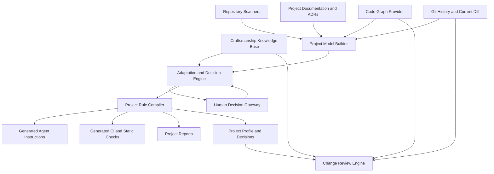

# CraftCompass

> **Project brief for an adaptive software-craftsmanship system**

**Working title:** CraftCompass  
**Status:** Concept / MVP planning  
**Primary use case:** Apply Robert C. Martin–inspired software craftsmanship principles to arbitrary software projects in a context-sensitive, evidence-based, and increasingly automated way.

---

## 1. Vision

CraftCompass translates general software craftsmanship principles into guidance and enforceable rules that fit the actual needs, architecture, maturity, and constraints of a specific project.

The system must not impose one fixed architecture or coding style on every repository. Instead, it should:

1. understand how a project is currently structured,
2. identify which craftsmanship principles are relevant,
3. interpret those principles in the project’s context,
4. generate project-specific rules and recommendations,
5. automate objective checks,
6. support semantic AI-assisted reviews,
7. minimize the number of decisions humans need to make.

The intended result is not a generic “Clean Code linter.” It is an adaptive decision system for software design and engineering quality.

---

## 2. Core idea

```text
Craftsmanship knowledge
        +
Repository structure and code relationships
        +
Architecture decisions and project constraints
        +
Current change context
        ↓
Project-specific engineering guidance
        ↓
LLM instructions, automated checks, reviews, and migration strategies
```

The system separates four kinds of responsibility:

```text
Deterministic tools collect facts.
The reasoning layer interprets facts and principles.
Generated project artifacts record decisions.
CI and review workflows enforce applicable rules.
```

GitNexus is a strong candidate for the first code-graph provider because it can expose symbols, dependencies, functional clusters, execution paths, change impact, and blast radius. CraftCompass should consume this information without becoming tightly coupled to GitNexus.

---

## 3. Problem statement

General principles such as SOLID, Clean Architecture, cohesive functions, dependency inversion, testability, and continuous refactoring are intentionally abstract.

They cannot be applied responsibly without context.

Examples:

- A strict domain/framework separation may be appropriate for a new business-critical service.
- The same separation may create unnecessary complexity in a small CRUD administration tool.
- In a legacy monolith, the correct first rule may be “introduce no new violations” rather than “repair the entire architecture.”
- A large method may be a design smell, but it may also express one coherent workflow more clearly than several artificial extractions.
- A central class may be a God class, or it may be an intentional application facade.

Existing static-analysis tools can find mechanical violations, but they cannot reliably interpret intent. LLMs can interpret intent, but they are not sufficiently deterministic or complete when discovering repository-wide relationships.

CraftCompass combines both approaches.

---

## 4. Goals

### 4.1 Primary goals

- Model software craftsmanship principles in a structured and reusable format.
- Analyze arbitrary repositories with minimal manual setup.
- Distinguish observed facts from interpretations and assumptions.
- Derive project-specific rules instead of enforcing generic dogma.
- Use code-graph evidence to improve architectural reasoning.
- Generate instructions for coding agents such as Codex or Claude Code.
- Generate or recommend deterministic checks where possible.
- Review a change against only the rules relevant to that change.
- Support legacy projects through baselines and ratcheting.
- Escalate only uncertain, high-impact decisions to humans.
- Keep every generated rule explainable and traceable.

### 4.2 Quality goals

- High precision rather than a large number of findings.
- Stable output when the repository has not materially changed.
- Explicit confidence levels for inferred information.
- Clear separation between blocking rules and recommendations.
- Minimal noise from pre-existing technical debt.
- Technology-independent core with replaceable adapters.

---

## 5. Non-goals

The MVP will not:

- reproduce or redistribute copyrighted books,
- treat Robert C. Martin’s work as an infallible or exclusive authority,
- require every project to use Clean Architecture,
- automatically perform repository-wide refactorings,
- replace human architectural responsibility,
- infer business intent with certainty from a static graph,
- build a new code-indexing engine if an existing provider is sufficient,
- become a complete SonarQube, IDE, CI platform, or source-code search engine,
- block builds based on subjective AI judgments without an explicit project decision.

The knowledge base should paraphrase principles, document their rationale, record source references, and include counter-indications. It should not contain extensive copied passages from books.

---

## 6. Design principles for CraftCompass itself

1. **Evidence before judgment**  
   Every architectural interpretation should point to repository evidence.

2. **Context before enforcement**  
   A principle becomes a rule only after its applicability has been evaluated.

3. **No false objectivity**  
   Subjective design guidance must not be presented as a deterministic fact.

4. **No-new-violations by default**  
   Existing technical debt should not make the system unusable.

5. **Human attention is scarce**  
   Ask humans only about decisions that are both uncertain and consequential.

6. **Replaceable infrastructure**  
   GitNexus, static analyzers, LLM providers, and CI systems are adapters.

7. **Explainable decisions**  
   Every rule must describe its principle, evidence, risk, scope, and enforcement strategy.

8. **Local change focus**  
   Reviews should focus on the current task and affected code paths, not produce unrelated repository-wide criticism.

9. **Pragmatism over ritual**  
   No interfaces, layers, classes, or abstractions should be introduced solely to appear compliant.

10. **Incremental improvement**  
    Craftsmanship is treated as an evolutionary process rather than a one-time certification.

---

## 7. Conceptual architecture



---

## 8. Main components

### 8.1 Craftsmanship Knowledge Base

The knowledge base contains atomic, structured principles.

Each principle should include:

- stable identifier,
- title,
- concise statement,
- rationale,
- positive signals,
- warning signals,
- counter-indications,
- applicable contexts,
- conflicts or tensions with other principles,
- possible enforcement mechanisms,
- source references,
- good and bad examples,
- confidence and review status.

Example:

```yaml
id: DESIGN-COHESION-001
title: Cohesive function
category: code-design

principle:
  statement: >
    A function should express one coherent intent at a consistent
    conceptual level.
  rationale: >
    Readers should not have to mentally separate unrelated responsibilities.

signals:
  positive:
    - one recognizable purpose
    - operations at a similar abstraction level
    - one meaningful reason to change
  warning:
    - validation, persistence, and formatting are mixed
    - unrelated side effects
    - section comments divide the function into separate jobs

counter_indications:
  - a small orchestration method may intentionally coordinate several steps
  - extraction would hide an important workflow
  - extracted methods would only forward arguments without adding meaning

enforcement:
  deterministic: limited
  ai_review: strong
  human_review: strong

sources:
  - work: Clean Code
    topic: Functions
```

The initial MVP should start with approximately 30–50 carefully curated principles rather than attempting to model every publication immediately.

Recommended first categories:

- names and readability,
- functions and classes,
- cohesion and coupling,
- SOLID,
- dependency direction,
- component boundaries,
- testability and test design,
- error handling,
- refactoring,
- legacy-code strategy,
- professional engineering practice.

---

### 8.2 Repository Intelligence

Repository Intelligence collects facts from several providers.

Potential sources:

- file and directory structure,
- language and framework detection,
- build files,
- package and module dependencies,
- static code graph,
- current Git diff,
- Git history and change coupling,
- test layout,
- CI configuration,
- static-analysis configuration,
- architecture documentation,
- ADRs,
- API definitions,
- database schemas.

The output must distinguish:

```yaml
facts: []
interpretations: []
assumptions: []
decisions: []
known_debt: []
uncertainties: []
```

Example:

```yaml
architecture:
  inferred_style: layered
  confidence: 0.82

  evidence:
    - controllers depend on services
    - services depend on repositories
    - package names follow controller/service/repository

  uncertainty:
    - it is unclear whether the layering is intentional or incidental
```

---

### 8.3 Code Graph Provider

The code graph is an adapter, not the core domain.

Initial implementation:

```text
GitNexusCodeGraphProvider
```

Possible interface:

```typescript
export interface CodeGraphProvider {
  analyzeRepository(): Promise<ProjectGraphSummary>;
  getSymbolContext(symbol: SymbolReference): Promise<SymbolContext>;
  analyzeImpact(symbol: SymbolReference): Promise<ImpactReport>;
  analyzeChanges(diff: GitDiff): Promise<ChangeImpactReport>;
  getExecutionFlows(): Promise<ExecutionFlow[]>;
  getFunctionalClusters(): Promise<FunctionalCluster[]>;
  query(request: GraphQuery): Promise<GraphQueryResult>;
}
```

Important constraints:

- Graph centrality alone is not a design defect.
- Membership in multiple clusters is a signal, not proof of an SRP violation.
- Missing static edges do not prove the absence of runtime dependencies.
- Reflection, dependency injection, proxies, events, configuration, and external systems may reduce graph completeness.
- Findings must state whether they are based on direct evidence or inference.

---

### 8.4 Project Model Builder

The Project Model Builder creates a normalized model independent of the source tools.

Example:

```yaml
project:
  name: order-service
  languages:
    - name: java
      version: 21
  frameworks:
    - spring-boot
  build:
    tool: maven

structure:
  modules:
    - name: domain
    - name: application
    - name: adapters

architecture:
  observed_patterns:
    - ports-and-adapters
  inferred_intent:
    value: hexagonal
    confidence: 0.74

constraints:
  production_system: true
  backward_compatibility: required
  migration_style: incremental

quality:
  tests:
    unit: present
    integration: present
    architecture: absent
  tools:
    - checkstyle
    - sonar

uncertainties:
  - whether JPA annotations in domain objects are accepted intentionally
```

---

### 8.5 Adaptation and Decision Engine

This is the main domain capability.

For each relevant principle, the engine evaluates:

1. Is the principle applicable?
2. Which project evidence activates it?
3. Which risk would it mitigate?
4. What would a reasonable implementation look like in this stack?
5. Is the project already compliant?
6. Would immediate enforcement be proportionate?
7. Can it be checked deterministically?
8. Is a migration strategy needed?
9. Which counter-indications apply?
10. Does a human decision need to be requested?

Possible outcomes:

```text
MANDATORY
RECOMMENDED
CONTEXTUAL
ASPIRATIONAL
NOT_APPLICABLE
REQUIRES_DECISION
```

Example for the same principle in different environments:

```yaml
principle: Dependency direction

new_business_service:
  level: mandatory
  rule: Domain code must not depend on Spring, persistence, or HTTP.

legacy_monolith:
  level: mandatory
  rule: No new framework dependencies may be introduced into domain code.
  migration: Existing violations are baselined.

small_crud_tool:
  level: contextual
  rule: Separate persistence models only when independent business behavior
        or expected interface variation justifies the additional mapping.
```

---

### 8.6 Human Decision Gateway

The system should not ask humans to review every generated observation.

A decision is escalated when:

```text
uncertainty is high
AND
the impact of a wrong decision is high
```

Examples:

- Is the detected architecture actually intentional?
- Is framework coupling in the domain accepted or transitional?
- May a rule block the build?
- Is backward compatibility mandatory?
- Should technical debt be stabilized or actively reduced?
- Is a module boundary technical or business-driven?

Decision record:

```yaml
id: DECISION-004
question: Should domain objects remain JPA entities?
status: accepted
answer: Yes, for the current product phase.
rationale: Separate models would add significant mapping cost with little benefit.
review_after: 2027-01-01
```

These decisions should become inputs to future runs so the same question is not repeatedly asked.

---

### 8.7 Project Rule Compiler

The compiler converts adapted principles and decisions into project artifacts.

Expected outputs:

```text
.craft/
├── project-profile.yaml
├── project-rules.yaml
├── architecture-observations.yaml
├── decisions.yaml
├── exceptions.yaml
├── baselines/
│   └── architecture-violations.yaml
├── generated/
│   ├── AGENTS.md
│   ├── review-instructions.md
│   ├── archunit/
│   └── static-analysis/
└── reports/
    └── initial-assessment.md
```

A project rule should be structured:

```yaml
id: ARCH-004
title: Application code must not depend on persistence adapters
level: mandatory
status: active

rule:
  from:
    - application
  must_not_depend_on:
    - adapter.out.persistence

principle_refs:
  - ARCH-DEPENDENCY-001
  - SOLID-DIP-001

evidence:
  - the project already defines repository ports
  - most application services depend on those ports
  - two recent changes bypassed the port boundary

risk:
  Persistence details can spread into application behavior and make
  alternative implementations or isolated tests harder.

scope:
  new_and_modified_code: true
  existing_violations: baseline

enforcement:
  - type: archunit
    blocking: true
  - type: ai-review
    blocking: false

exceptions:
  require_documented_reason: true
```

---

### 8.8 Change Review Engine

The review engine evaluates the current change, not the entire repository.

Workflow:

```text
Read current diff
→ identify changed symbols
→ query GitNexus for affected symbols, processes, and clusters
→ select relevant project rules and principles
→ execute deterministic checks
→ perform semantic review
→ report only relevant findings
```

A finding should contain:

```yaml
id: FINDING-202
severity: high
confidence: 0.94

rule: ARCH-004
principle: Dependency Inversion

changed_location:
  file: src/main/java/.../OrderService.java
  symbol: createOrder

evidence:
  new_dependency:
    from: application.OrderService
    to: infrastructure.JpaOrderRepository
  affected_flows:
    - checkout
    - recurring-orders

consequence:
  Application behavior now depends on a persistence implementation.

smallest_reasonable_correction:
  Inject and use the existing OrderRepository port.

blocking: true
```

The engine should suppress findings that are:

- unrelated to the current change,
- merely stylistic preferences,
- based only on line-count thresholds,
- speculative without evidence,
- already covered by an accepted exception,
- aspirational but presented as blocking,
- duplicates of deterministic tool output without added interpretation.

---

## 9. Main workflows

### 9.1 Initialize a project

Possible command:

```bash
craft init
```

Steps:

1. Detect language, frameworks, build system, tests, and quality tools.
2. Index or refresh the repository in GitNexus.
3. Retrieve graph summary, clusters, representative flows, and central symbols.
4. Read project documentation, ADRs, and CI files.
5. Build the normalized project model.
6. Select relevant craftsmanship principles.
7. Derive candidate rules.
8. Automatically accept low-risk, high-confidence rules.
9. Request only high-impact uncertain decisions.
10. Generate `.craft/` artifacts and agent instructions.
11. Optionally generate deterministic checks.

---

### 9.2 Guide an implementation

Possible command:

```bash
craft guide --task "Add recurring order cancellation"
```

Output:

- relevant modules and existing patterns,
- likely impacted flows,
- applicable project rules,
- relevant craftsmanship principles,
- expected tests,
- known exceptions,
- architecture constraints,
- suggested files to inspect.

The guide must not prescribe a complete implementation before inspecting the affected code.

---

### 9.3 Review a change

Possible command:

```bash
craft review
```

Inputs:

- Git diff,
- affected symbols and flows,
- project rules,
- baselines,
- exceptions,
- deterministic check results.

Outputs:

- blocking findings,
- non-blocking recommendations,
- affected execution flows,
- test gaps,
- confidence and evidence,
- optional smallest reasonable fixes.

---

### 9.4 Reassess a project

Possible command:

```bash
craft reassess
```

Triggers:

- scheduled architecture review,
- major dependency upgrade,
- module split or merge,
- substantial refactoring,
- new framework,
- changed deployment model,
- accepted architecture decision.

Questions:

- Does the project model still match reality?
- Have architecture boundaries moved?
- Can baselined violations now be reduced?
- Should aspirational rules become mandatory?
- Are rules obsolete or counterproductive?
- Are new deterministic checks available?

---

## 10. GitNexus integration strategy

### 10.1 Why GitNexus fits

GitNexus can provide evidence for:

- symbol relationships,
- direct and indirect dependencies,
- functional clusters,
- execution paths,
- impact radius,
- changed symbols,
- affected processes,
- central integration points.

This reduces the need for an LLM to reconstruct the entire repository from partial file reads.

### 10.2 What GitNexus must not decide

GitNexus should not independently conclude:

- a central symbol violates SRP,
- a large blast radius proves bad architecture,
- a cross-cluster dependency is always wrong,
- an existing dependency represents intended architecture,
- a missing edge proves there is no runtime relationship.

Its role is:

```text
Evidence provider, not craftsmanship authority.
```

### 10.3 Integration stages

**MVP**

- Use the existing GitNexus MCP server.
- Let a CraftCompass skill orchestrate queries and interpretation.
- Persist normalized results in `.craft/`.

**Later**

- Implement a typed GitNexus adapter.
- Add caching and index freshness checks.
- Add provider-independent graph models.
- Support alternative graph providers.
- Compare static graph evidence with runtime or CI evidence.

---

## 11. Suggested technical approach

The core should be independent of MCP.

Recommended shape:

```text
craftcompass/
├── apps/
│   ├── cli/
│   └── mcp-server/
├── packages/
│   ├── domain/
│   ├── knowledge-base/
│   ├── project-model/
│   ├── adaptation-engine/
│   ├── rule-compiler/
│   ├── review-engine/
│   ├── providers-gitnexus/
│   ├── providers-filesystem/
│   ├── providers-git/
│   └── generators/
├── principles/
├── schemas/
├── examples/
└── docs/
```

A TypeScript implementation is a pragmatic MVP choice because:

- MCP tooling is commonly available in the TypeScript ecosystem,
- YAML/JSON schema handling is straightforward,
- CLI development is simple,
- adapters can be implemented cleanly,
- the project can later expose both CLI and MCP interfaces.

The architecture should still allow another language if practical constraints favor it.

---

## 12. Domain model sketch

```typescript
export type RuleLevel =
  | "mandatory"
  | "recommended"
  | "contextual"
  | "aspirational"
  | "not_applicable"
  | "requires_decision";

export interface CraftsmanshipPrinciple {
  id: string;
  title: string;
  category: string;
  statement: string;
  rationale: string;
  positiveSignals: string[];
  warningSignals: string[];
  counterIndications: string[];
  applicableContexts: ApplicabilityRule[];
  enforcementOptions: EnforcementOption[];
  sourceReferences: SourceReference[];
}

export interface ProjectObservation {
  id: string;
  type: "fact" | "interpretation" | "assumption" | "uncertainty";
  statement: string;
  confidence: number;
  evidence: EvidenceReference[];
}

export interface ProjectRule {
  id: string;
  title: string;
  level: RuleLevel;
  statement: string;
  principleRefs: string[];
  evidence: EvidenceReference[];
  scope: RuleScope;
  risk: string;
  enforcement: EnforcementConfiguration[];
  migration?: MigrationStrategy;
  exceptions?: ExceptionPolicy;
}

export interface ReviewFinding {
  id: string;
  severity: "critical" | "high" | "medium" | "low";
  confidence: number;
  ruleId: string;
  evidence: EvidenceReference[];
  consequence: string;
  correction: string;
  blocking: boolean;
}
```

---

## 13. MVP scope

The MVP should prove one central hypothesis:

> Structured craftsmanship principles combined with repository graph evidence can produce useful project-specific rules and precise diff reviews with little human input.

### 13.1 MVP capabilities

1. Load a small structured principle catalog.
2. Analyze a repository’s basic technology and structure.
3. Use GitNexus MCP for graph context and change impact.
4. Generate a normalized project profile.
5. Derive project-specific candidate rules.
6. Mark rules by level and confidence.
7. Persist decisions and exceptions.
8. Generate an `AGENTS.md` file.
9. Review the current Git diff.
10. Produce evidence-based findings linked to rule IDs.

### 13.2 Initial limitations

- Java/Spring repositories can be the first optimized target.
- Other technologies should be accepted but may receive less specialized output.
- No automatic code modification is required.
- ArchUnit generation can be limited to a small set of dependency rules.
- Human decisions can initially be collected through a generated Markdown report.
- One LLM provider is sufficient for the prototype.
- GitNexus is the only graph provider in the MVP.

---

## 14. MVP acceptance criteria

The MVP is successful when it can run against three different repositories:

1. a new, well-structured service,
2. a legacy monolith,
3. a small application with intentionally simple architecture.

It should produce meaningfully different rules for each project.

Required outcomes:

- Facts and inferences are visibly separated.
- Every generated rule references at least one principle and project evidence.
- Existing violations can be baselined.
- Aspirational guidance is not reported as a blocking failure.
- Diff review focuses on changed and affected code.
- Re-running without material changes produces mostly stable output.
- Human questions are limited to high-impact uncertainty.
- At least one architecture rule can be generated as an executable check.
- Findings explain consequences rather than only naming a principle.
- The system avoids recommending abstraction without a current reason.

---

## 15. Evaluation metrics

### Precision

```text
How many reported findings are accepted as relevant by developers?
```

### Context sensitivity

```text
Does the system produce different rules for different project needs?
```

### Stability

```text
Does an unchanged repository produce largely unchanged results?
```

### Explainability

```text
Can every rule and finding be traced to principle, evidence, risk, and scope?
```

### Human effort

```text
How many questions require human input, and how many are genuinely valuable?
```

### Change focus

```text
How often does the review report unrelated repository-wide issues?
```

### Architectural improvement

```text
Does the project reduce or at least stop increasing important violations over time?
```

---

## 16. Risks

### 16.1 Dogmatic knowledge modeling

**Risk:** Principles become simplistic rules.

**Mitigation:** Every principle includes counter-indications and contextual applicability.

### 16.2 Existing patterns mistaken for intended architecture

**Risk:** The system codifies technical debt as a standard.

**Mitigation:** Separate observations, interpretations, decisions, and debt.

### 16.3 LLM inconsistency

**Risk:** Repeated analysis creates unstable rules.

**Mitigation:** Structured schemas, deterministic evidence, cached decisions, temperature control, and regression fixtures.

### 16.4 Incomplete code graphs

**Risk:** Reflection, dependency injection, events, or runtime configuration are missed.

**Mitigation:** Explicit confidence, provider limitations, framework-aware scanners, and optional runtime evidence.

### 16.5 Review noise

**Risk:** Developers ignore the system.

**Mitigation:** Current-diff focus, severity thresholds, deduplication, baselines, and precision metrics.

### 16.6 Copyright and attribution

**Risk:** The knowledge base reproduces protected text.

**Mitigation:** Paraphrase principles, store concise source references, and avoid extensive quotations.

### 16.7 Vendor lock-in

**Risk:** The project becomes dependent on one graph or LLM provider.

**Mitigation:** Provider interfaces and normalized internal models.

---

## 17. Proposed implementation phases

### Phase 0 — Research fixtures

- Select three representative repositories.
- Define ten example architecture and code-design situations.
- Write expected outcomes manually.
- Use them as evaluation fixtures throughout development.

### Phase 1 — Principle model

- Define YAML and JSON schemas.
- Create the first 30–50 principles.
- Add counter-indications and enforcement metadata.
- Add schema validation tests.

### Phase 2 — Repository model

- Detect languages, frameworks, modules, tests, and build tools.
- Parse existing documentation and quality configuration.
- Define facts, interpretations, assumptions, and uncertainties.

### Phase 3 — GitNexus adapter

- Query repository summary.
- Retrieve clusters and execution flows.
- Resolve context for representative symbols.
- Analyze the current diff.
- Normalize all results behind `CodeGraphProvider`.

### Phase 4 — Adaptation engine

- Match principles to project evidence.
- Produce candidate project rules.
- Assign level, confidence, scope, and migration strategy.
- Generate human decisions only where required.

### Phase 5 — Rule compiler

- Generate `.craft/project-profile.yaml`.
- Generate `.craft/project-rules.yaml`.
- Generate `AGENTS.md`.
- Generate a human-readable initial assessment.
- Generate initial ArchUnit rules for Java projects.

### Phase 6 — Diff review

- Select relevant rules based on changed symbols and impacted flows.
- Run deterministic checks.
- Perform semantic review.
- Produce structured findings and Markdown output.

### Phase 7 — Productization

- Add CLI.
- Add MCP server as an adapter.
- Add GitHub/GitLab integration.
- Add rule drift detection.
- Add scheduled reassessment.
- Add additional graph and static-analysis providers.

---

## 18. First development backlog

### Epic 1 — Repository foundation

- Initialize the monorepo.
- Configure TypeScript, linting, formatting, and tests.
- Create domain and adapter packages.
- Add YAML loading and schema validation.
- Add example fixture repositories or synthetic project snapshots.

### Epic 2 — Principle schema

- Define `CraftsmanshipPrinciple`.
- Define source-reference and enforcement schemas.
- Create ten initial principles.
- Add validation and snapshot tests.
- Document knowledge-authoring guidelines.

### Epic 3 — Project profile

- Detect language and build tool.
- Detect source and test roots.
- Detect common framework dependencies.
- Detect existing quality tools.
- Serialize `project-profile.yaml`.

### Epic 4 — GitNexus integration

- Define `CodeGraphProvider`.
- Implement GitNexus MCP adapter.
- Load repository graph summary.
- Query symbol context and impact.
- Analyze a Git diff.
- Add a fake provider for deterministic tests.

### Epic 5 — Rule derivation

- Define `ProjectRule`.
- Implement relevance scoring.
- Implement rule levels.
- Implement confidence and evidence requirements.
- Support baseline and no-new-violations strategies.

### Epic 6 — Generated instructions

- Generate `.craft/project-rules.yaml`.
- Generate `AGENTS.md`.
- Generate `review-instructions.md`.
- Preserve human-authored decisions between regenerations.

### Epic 7 — Review workflow

- Read current Git diff.
- Determine affected symbols and flows.
- Select relevant rules.
- Generate structured review findings.
- Render findings as Markdown.
- Suppress unrelated and accepted findings.

---

## 19. Suggested first vertical slice

The first end-to-end slice should be deliberately narrow:

```text
Java/Spring repository
        ↓
GitNexus project and diff context
        ↓
Five dependency-related principles
        ↓
Project profile
        ↓
Three project-specific architecture rules
        ↓
Generated AGENTS.md
        ↓
Diff review with evidence
```

Recommended first principles:

1. Dependency direction.
2. Dependency inversion.
3. Separation of policy and technical detail.
4. Cohesion of application services.
5. Change-focused incremental improvement.

This slice validates the product concept before investing in a large knowledge base.

---

## 20. Initial Codex task

The first Codex session can begin with this task:

```text
Create the initial CraftCompass repository as a TypeScript monorepo.

Objectives:
1. Create packages for domain, knowledge-base, project-model,
   providers-gitnexus, adaptation-engine, rule-compiler, and cli.
2. Define TypeScript interfaces for:
   - CraftsmanshipPrinciple
   - ProjectObservation
   - ProjectProfile
   - ProjectRule
   - CodeGraphProvider
   - ReviewFinding
3. Add JSON Schema or Zod validation for principle and project-rule YAML files.
4. Add one complete example principle for dependency direction.
5. Add one example project profile and one derived project rule.
6. Implement a CLI command that validates and prints these fixtures.
7. Add unit tests and a concise architecture document.
8. Keep all provider-specific code outside the domain packages.
9. Do not implement LLM calls or GitNexus integration yet.
10. Prefer the smallest coherent implementation that establishes the domain model.
```

---

## 21. Naming ideas

### Recommended

#### CraftCompass

**Meaning:** Craftsmanship principles provide direction, while project context determines the route.

Advantages:

- communicates guidance rather than rigid enforcement,
- works beyond one author or methodology,
- suitable for CLI, MCP, and product naming,
- easy command name: `craft`,
- supports phrases such as “project compass,” “architecture compass,” and “review compass.”

Possible tagline:

> **Context-aware software craftsmanship.**

### Alternatives

#### PrincipleForge

General principles are forged into project-specific rules.

#### ContextCraft

Emphasizes that craftsmanship must be adapted to its environment.

#### CraftLens

Views a codebase through the lens of software craftsmanship principles.

#### CodeCompass

Clear and approachable, but broader and less distinctive.

#### CraftGraph

Highlights the combination of craftsmanship knowledge and code-graph evidence.

#### DesignBearing

A “bearing” is both a direction and a way of carrying or supporting load.

#### PraxisCode

Emphasizes turning theory into practical project decisions.

#### CodeSteward

Focuses on responsible long-term care of a codebase.

#### ArchCraft

Short and direct, but may sound limited to architecture.

#### ContextForge

Highlights the transformation of context into concrete engineering guidance.

---

## 22. One-sentence project description

> **CraftCompass is an AI-assisted software craftsmanship system that combines structured engineering principles with repository and code-graph evidence to generate explainable, project-specific guidance, automated checks, and change-focused reviews.**

---

## 23. Short repository description

> Adapt software craftsmanship principles to the actual architecture, constraints, and changes of any codebase.

